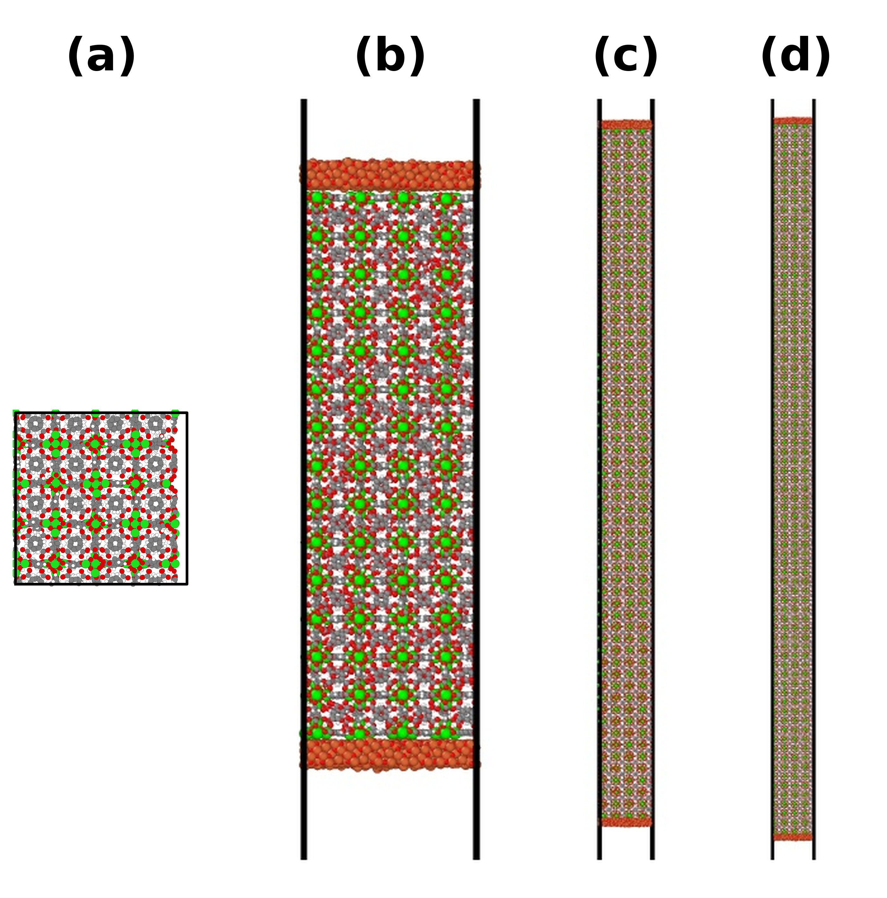
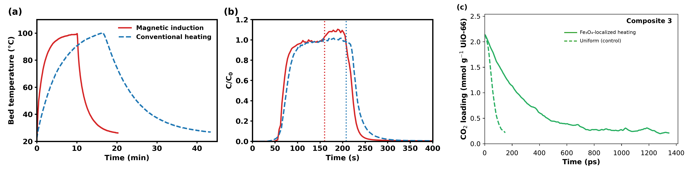

# Direct Air Capture of CO₂ by a UiO-66/Fe₃O₄ Composite: Experiments and Molecular Simulations

This repository contains the LAMMPS input scripts, structure files, analysis tools, and the computed and measured data that accompany the article

> S. Jalalmanesh, X. Jia, F. Rezaei, and M. Sahimi, *Experimental Study and Molecular Dynamics Simulations of Direct Air Capture of CO₂ by a Metal-Organic Framework - Iron Oxide Composite*, Langmuir (under review).

<p align="center">
  
</p>

## Overview

UiO-66, a Zr-based metal-organic framework, was combined with Fe₃O₄ to obtain a sorbent that can be regenerated by magnetic induction. The study combines

* **experiments**: CO₂ isotherms of UiO-66, Fe₃O₄@UiO-66, and bare Fe₃O₄; fixed-bed breakthrough measurements with pure CO₂, CO₂/N₂ mixtures, and humid CO₂; specific absorption rate (SAR) measurements; and a comparison of magnetic induction swing adsorption (MISA) with conventional temperature swing adsorption (TSA);
* **simulations**: hybrid molecular dynamics and grand canonical Monte Carlo (MD–GCMC) simulations in LAMMPS of the adsorption of CO₂, N₂, their mixture, and CO₂ with water in UiO-66 and in Fe₃O₄/UiO-66/Fe₃O₄ composites, and of the desorption of CO₂ when only the Fe₃O₄ slabs are heated.

<p align="center">
  
</p>

## Repository structure

```
lammps/
  adsorption/   MD–GCMC isotherms: CO2, N2, CO2/N2, and CO2 + H2O in UiO-66, and CO2 in the composite
  composite/    relaxation of UiO-66 and Fe3O4, cutting and capping of the slab, assembly and equilibration of the composite
  desorption/   magnetic (Fe3O4-localized) and uniform desorption
structures/     UiO-66 and Fe3O4 data files, the equilibrated Composite 3, and molecule files of CO2, N2, and H2O
analysis/       fugacity calculation, isotherm fits and thermodynamics, and desorption metrics
data/
  computed/     processed simulation results reported in the article and the Supporting Information
  measured/     measured isotherms, breakthrough curves, bed temperatures, and SAR data
docs/           figures used in this page
```

Each folder contains a README that describes its files; `lammps/composite/README.md` describes the construction of the composite step by step.

## Models and methods

| Component | Model |
|---|---|
| UiO-66 framework | UFF with DDEC charges |
| Fe₃O₄ | ClayFF-based model of Gürsoy et al. |
| Unlike pairs | Lorentz–Berthelot mixing rules; Fe₃O₄–framework cross terms from the UFF parameters and the Fe and O parameters of Kerisit et al. |
| CO₂, N₂ | TraPPE (rigid) |
| H₂O | SPC/E (rigid) |
| Electrostatics | Ewald summation (accuracy 10⁻⁴), with the slab correction for the composites |
| Fugacities | modified Benedict–Webb–Rubin equation of state |

Uptakes of the composites are reported per gram of UiO-66. Full details are given in Section 3 of the article and in Sections S2 to S8 of the Supporting Information.

## Software requirements

* LAMMPS with the MOLECULE, EXTRA-MOLECULE, KSPACE, MC, and RIGID packages
* Python 3.9 or later with the packages listed in `requirements.txt`

```bash
pip install -r requirements.txt
```

## Workflow

1. **Fugacities.** Compute the fugacities at the temperatures and pressures of interest with `analysis/fugacity_mbwr.ipynb`.
2. **Isotherms in UiO-66.** Run `lammps/adsorption/in.gcmc_CO2`, `in.gcmc_N2`, `in.gcmc_CO2_N2`, and `in.gcmc_CO2_H2O`, with the pressures in `P_list` and the fugacities in `f_list` (or `fC_list` and `fN_list`).
3. **Composite.** Build and equilibrate the composite as described in `lammps/composite/README.md` (or start from the equilibrated Composite 3 in `structures/Composite3_UiO66_Fe3O4.data`), and compute its CO₂ isotherm with `lammps/adsorption/in.gcmc_composite_CO2`.
4. **Desorption.** Starting from the CO₂-loaded composite at 1 bar, run `lammps/desorption/in.desorption_magnetic` and `lammps/desorption/in.desorption_uniform`.
5. **Analysis.** Convert the output into uptakes and fit the isotherms with `analysis/adsorption_analysis.py`, and analyze the desorption runs with `analysis/desorption_metrics.py`.

The names of the data files, the pressures, the fugacities, and the other system-specific quantities are placeholders in the USER INPUTS block of each script and must be set by the user. All values reported in the article and the Supporting Information are given in `data/computed/`.

## Citation

If you use these files, please cite the article above. A machine-readable citation is provided in `CITATION.cff`.

## License

The code (LAMMPS input scripts and analysis tools) is released under the MIT License (`LICENSE`). The data in `data/` are released under the Creative Commons Attribution 4.0 International License (`data/LICENSE`).

## Contact

Muhammad Sahimi, Mork Family Department of Chemical Engineering and Materials Science, University of Southern California (moe@usc.edu)
